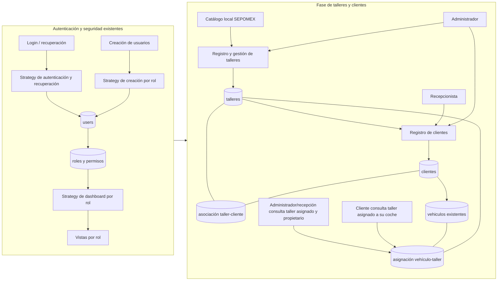

# Sistema actual y fase de talleres/clientes

La Strategy se muestra únicamente en autenticación, creación de cuentas, recuperación y dashboard, donde ya existe. Talleres, clientes, sus asociaciones, vehículos y SEPOMEX se representan sin Strategy. Un cliente puede asociarse a varios talleres; cada vehículo tiene una asignación propia a un taller específico, independiente de esa asociación.
